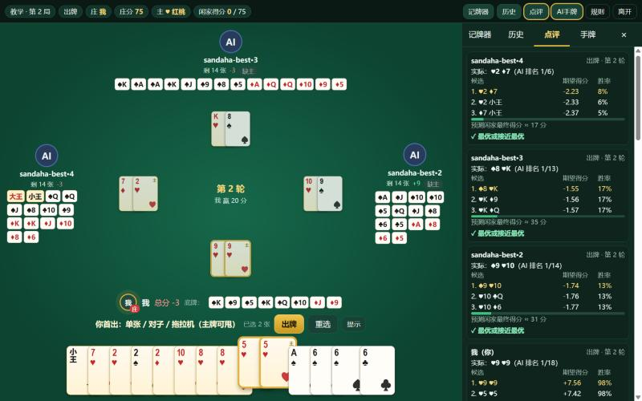
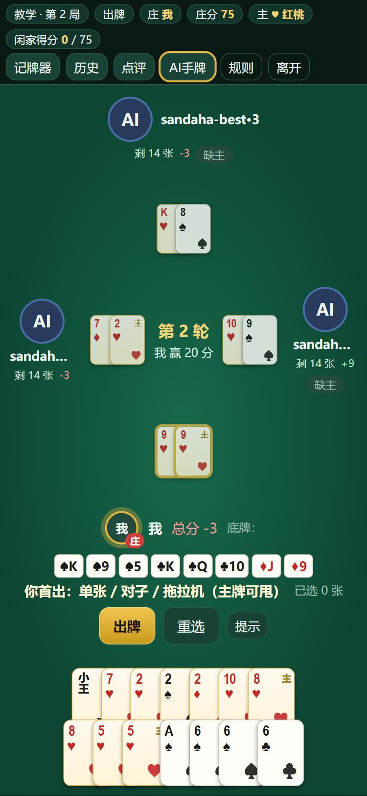
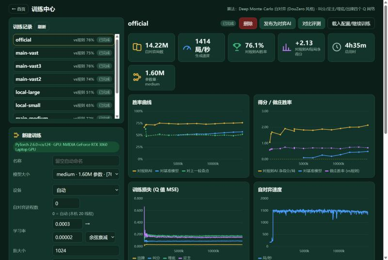

# SanDaHa-Zero · 三打哈 AI (v2.2)

**English** | [中文](README.zh-CN.md)

A self-play reinforcement-learning AI for **San Da Ha (三打哈)**, the Hunan trick-taking card game. It ships with a one-click local web client, a standalone **Windows one-click executable (`.exe`)**, and a standalone **Android app (`.apk`)**: play against the AI, play over your LAN, study move-by-move commentary in teaching mode, and train models from a visual dashboard.

- **Full rules**: bidding (including the forced-bid rule for 7+ permanent trumps), trump choice (including no-trump), surrender, burying the bottom, singles / pairs / tractors, trump throws (**side-suit throws are not allowed**), ruffing and discarding, bottom-capture (扣底) multipliers, and the complete 大光/小光/保庄/下庄/小倒/大倒 settlement. See [docs/RULES.zh-CN.md](docs/RULES.zh-CN.md).
- **One model makes every decision**: bidding, trump or surrender, burying, and card play (including going for 扣底), directly optimizing **expected settlement score including multipliers**.
- **v2.2 Double-In Single-Out (`双进单出`) Breakthrough**: switches default rules to authentic Hunan **双进单出** (Banker wins pay double: 保庄 ×2, 小光 ×4, 大光 ×6) and trains `sandaha-best` (**51.1M games**, 4.67M params) & `sandaha-lite` (**23.5M games**, 2.37M params) with **Auction-Ladder Bid Exploration + Phase-Decoupled AdamW + SWA**. Self-play average contract drops from `76.8` to **`64.0`** (`46.9%` of hands contested `< 70` down to `60/50/40/5`), beating v2.0 `sandaha-best` by **`+0.29` net base stakes/game** and `RuleBot` by **`+2.32` net base stakes/game** over 6,000 duplicate games.
- **Zero-setup deployment**: inference uses pure `numpy` (no PyTorch or GPU required). Grab the ready-to-run Windows `.exe` or Android `.apk` from Releases.



<p> </p>

## Quick start

### Option 1: Standalone One-Click Releases (Recommended)

Download from [**GitHub Releases**](https://github.com/wlx7/sandaha-zero/releases/latest):

- **Windows (x64)**: download `SanDaHa-Zero-Windows-x64.exe` and double-click to launch (pure play & teaching edition with training stripped out; bundles both v2.2 `sandaha-best` and `sandaha-lite` models — no Python install needed).
- **Android (`arm64-v8a` / `x86_64`)**: install `SanDaHa-Zero-Android.apk` to play offline or host LAN rooms right from your phone (native immersive landscape mode + automatic 90° landscape stage for mobile browsers even under portrait lock, with full 16 KB page-size support for Android 15/16 via Chaquopy 17 + Python 3.13).

### Option 2: Run from Source

**Windows**: double-click `start.bat`. **macOS / Linux**: run `./start.sh`.

```bash
uv run sandaha                      # or: pip install -e . && sandaha
sandaha --port 9000 --no-browser
```

## What's New in v2.0

Diagnosing the v1.0 53.7M-game MLP revealed three root causes of its plateau: **62.2% dead/dormant first-layer ReLU neurons** (`478 / 768` units `< 1%` active), **`uint8` replay quantization wraparound** on unclipped scalar features, and **missing tactical state** (discarded bidding history and untracked pair voids). v2.0 resolves all three:

1. **Dueling FiLM-ResNet (`dueling_film_v2`)**: Pre-LN Residual State Tower (`LayerNorm` + `LeakyReLU(0.05)`) + unbiased Dueling decomposition $Q(s,a) = V(s) + A(s,a)$ with auxiliary state-value supervision + `tanh`-bounded FiLM multiplicative state-action gating, while keeping pure-`numpy` single-decision latency around ~1.5 ms.
2. **Tactical Feature Set v2 (`feat_ver=2`, Play: 1,027 state + 116 action dims)**: strictly `[0, 1]`-clipped encodings adding incremental **pair-void deduction (`pair_void`)**, **unforced-pass permanent-trump (`changzhu < 7`) inference**, **bidding memory**, **settlement tier margin features**, and **boss-card / closing-4th-seat certainty indicators**.
3. **Upgraded DMC Learner & League Self-Play**: per-phase `AdamW` optimizers, Polyak EMA (`0.9995`), Ape-X multi-scale plausible Q-noise exploration, League matches against historical checkpoints + v1 baseline + `RuleBot`, True-MDP low-LR cosine fine-tuning (`no_surrender_frac=0.02`), and late-stage Stochastic Weight Averaging (SWA).
4. **Belief-Weighted Batched Search (`SearchAgent` v2)**: determinization constrained by suit voids, `pair_void`, bidding caps, and realistic Banker bury priors, rolled out in lockstep batches via `model.q_batch`.

## Benchmark Results (v2.0)

### Default Champion: `models/sandaha-best.npz` (v2.0 `medium`, 4.67M params, 45.2M games)

Each row is **6,000 duplicate deals × seat swap = 12,000 games** (± is 95% CI; full JSON in [`docs/results.json`](docs/results.json)):

| Opponent | Win rate | Net score / game | Our banker rate | Banker win rate |
|---|---|---|---|---|
| Rule-based AI (`RuleBot`) | **76.1% ± 0.8** | **+2.21** | 17.8% | 69.9% |
| Random (`RandomBot`) | 99.9% ± 0.0 | +5.63 | 0.3% | — |
| **Previous release v1.0 `medium` (53.7M games)** | **52.2% ± 0.9** | **+0.13** | 48.7% | 51.1% |
| Same v2 run @ 14.7M games | 51.8% ± 0.9 | +0.12 | 50.7% | 49.0% |
| Same v2 run @ 30.8M games | 50.4% ± 0.9 | +0.04 | 50.8% | 47.7% |
| Lightweight v2.0 `sandaha-lite` (12.6M games) | 51.9% ± 0.9 | +0.14 | 49.4% | 49.7% |
| Old lightweight v1.0 `sandaha-lite` (405k games) | 62.6% ± 0.9 | +1.00 | 51.2% | 61.4% |

### Lightweight Model: `models/sandaha-lite.npz` (v2.0 `small`, 2.37M params, 12.6M games)

Each row is **2,992 duplicate deals × seat swap = 5,984 games**:

| Opponent | Win rate | Net score / game | Our banker rate | Banker win rate |
|---|---|---|---|---|
| Rule-based AI (`RuleBot`) | **76.0% ± 1.1** | **+2.14** | 18.0% | 71.7% |
| **Previous release v1.0 `medium` (53.7M games)** | **49.5% ± 1.3** | **−0.03** | 49.0% | 49.6% |
| Old lightweight v1.0 `small` (405k games) | **61.6% ± 1.2** | **+0.89** | 51.7% | 61.4% |

- **Player profiles**: a "who is playing?" picker on first launch; create, rename or delete users. Every finished hand is added to the active user's record (hands, win rate, total score, banker win rate, longest streak, last 40 hands). Profiles live on the machine that runs the server (`data/profiles.json` next to the EXE); LAN guests pick from the host's list, and one profile can be used by one device at a time. **Guest mode** plays under a nickname only: nothing is saved, the score lives on the table until the game ends.
- **Optional Search (`?search`)**: over 1,600 duplicate games against plain v2.0 `sandaha-best`, belief-weighted batched rollout search (`sandaha-best?search`) scores **49.9% ± 2.4** (**−0.04** base stakes/game).

## Layout

```
sandaha/   cards, rules, moves, engine (pure Python rules engine + pair_void & bid memory)
           bots/ (rule-based baseline), ai/ (v1/v2 features, Dueling FiLM-ResNet numpy inference, batched search)
           train/ (DMC actors + learner, PyTorch nets, CLI), server/ (FastAPI + zero-dep stdlib lite_server), web/
android/   Standalone Android app project (Gradle + Chaquopy embedded Python 3.11)
scripts/   Benchmark suite (benchmark.py), PyInstaller one-file builder (build_windows.py), cloud helpers
models/    Pretrained v2.0 models: sandaha-best.npz (default, medium), sandaha-lite.npz (lightweight, small)
runs/      Official v2.0 training metrics & evaluation curves
docs/      Rules, training guide (EN/ZH), and benchmark results.json
tests/     pytest unit test suite
```

## License

**[PolyForm Noncommercial 1.0.0](LICENSE)**:
- Free for personal, research, hobby, educational and non-profit use.
- **Commercial use requires a separate license.** Contact the author via GitHub Issues.
