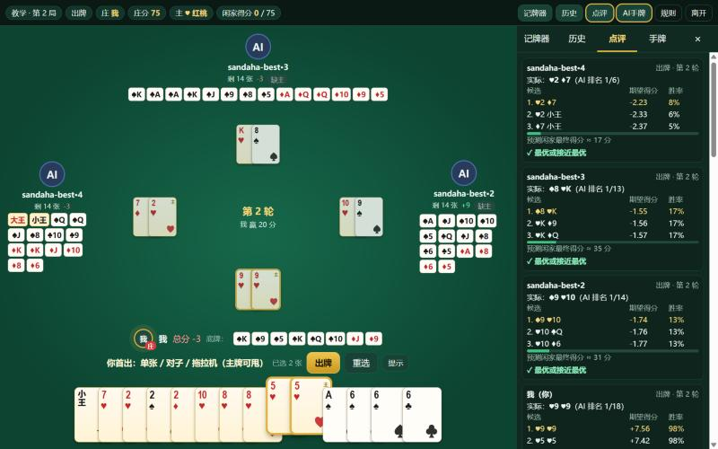
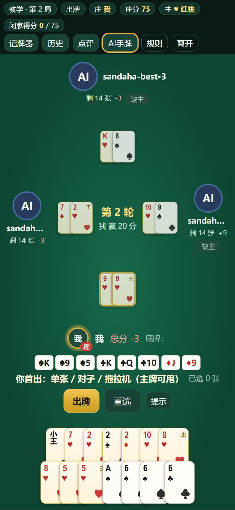
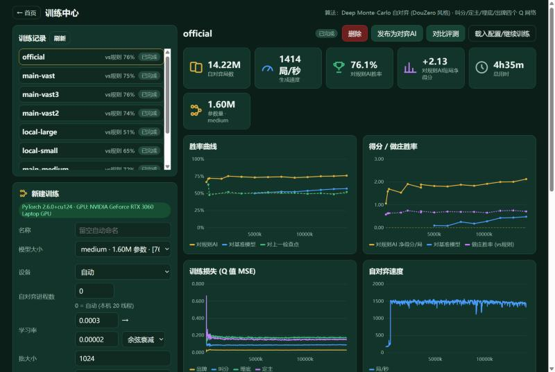

# SanDaHa-Zero · 三打哈 AI (v2.2)

[English](README.md) | **中文**

湖南扑克“三打哈”的自对弈强化学习 AI，附带一键启动的本地网页客户端、Windows 免安装单文件版与 Android 手机独立安装包：人机对战、局域网联机、教学点评、可视化训练中心。

- **完整规则**：叫分（含常主强制叫分）、定主（含无主）、投降、埋底、单张/对子/拖拉机、主牌甩牌（**不允许甩副牌**）、毙牌垫牌、扣底倍数、大光/小光/保庄/下庄/小倒/大倒结算。规则细节可配置，见 [docs/RULES.zh-CN.md](docs/RULES.zh-CN.md)。
- **一个模型包揽所有决策**：叫分、选主/投降、埋底、出牌（含扣底）。训练目标是**期望得分**（含倍数），胜率和倍数会被综合考虑。
- **v2.2 湖南标准「双进单出」专训升级**：默认规则全面切换为湖南主流 **双进单出**（庄家获胜倍数翻倍：保庄 ×2、小光 ×4、大光 ×6）。采用全新 **阶梯竞价探索（Auction-Ladder Exploration）+ 阶段解耦学习率** 训练至 **5,107 万局**（主力 `sandaha-best`）与 **2,347 万局**（轻量 `sandaha-lite`）：4 家 AI 自对弈平均叫分从单进单出的 `76.8` 分下探至 **`64.0` 分**（低于 70 分抢庄占比从 `3.0%` 提升至 **`46.9%`**，覆盖 `65→60→50→40→20→5` 全段位激烈抢庄），6,000 局复式赛对 v2.0 主力模型每局净赢 **`+0.29` 底注**，对双进单出规则 AI 每局净赢 **`+2.32` 底注**。
- **多端开箱即用**：对弈只依赖 numpy（不需要 PyTorch / GPU）。Release 页面直接提供 **Windows 一键运行 `.exe`** 和 **Android 手机 `.apk`**。



<p> </p>

## 快速开始

### 方式一：免安装一键包（推荐）

前往 [**GitHub Releases**](https://github.com/wlx7/sandaha-zero/releases/latest) 下载对应平台文件：

- **Windows 电脑**：下载 `SanDaHa-Zero-Windows-x64.exe`，双击即可启动本地服务并打开浏览器（纯粹对弈/教学精简版，剥离训练依赖，内置 `sandaha-best` 与 `sandaha-lite` 双 v2.2 模型，无需安装 Python）。
- **Android 手机 / 平板**：下载 `SanDaHa-Zero-Android.apk` 安装即可离线畅玩对战模式与教学点评（原生全屏横屏体验，支持 Android 15/16 / ColorOS 16 的 16KB 内存页架构，内置 Python 3.13 + NumPy 推理引擎；同一 Wi-Fi 下其他手机扫码打开浏览器也会自动切换横屏画布）。

### 方式二：从源码运行

**Windows**：双击 `start.bat`。  
**macOS / Linux**：运行 `./start.sh`。

首次运行会自动安装 [uv](https://github.com/astral-sh/uv) 和依赖（约 1 分钟），然后在浏览器打开 `http://127.0.0.1:8765`。同一局域网内的手机或电脑可以访问首页显示的地址（或扫描二维码）加入游戏。

```bash
uv run sandaha            # 或: pip install -e . && sandaha
sandaha --port 9000 --no-browser
```

> Windows 防火墙首次运行可能弹窗，需要允许访问“专用网络”，局域网内其他设备才能连进来。

## 功能

### 对弈

| 模式 | 说明 |
|---|---|
| **对战模式** | 4 个座位可任意设为“我（本机）/ 等待玩家加入 / AI（可选模型、搜索增强或规则AI）”。局域网其他设备打开网址后加入房间、点击“坐这里”入座。每步限时 **30 秒**，超时后系统在规则范围内随机出牌（叫分超时视为不叫）。座位全设为 AI 即可观战。 |
| **教学模式** | 本机与 3 个 AI 对局，**不限时**。可显示所有 AI 手牌；每一步（包括你自己的）都有 AI 点评：候选动作排名、期望得分（底注）、胜率、预测闲家最终得分，并判定“最优/可接受/失误”。随时可以点“提示”，AI 会自动帮你选好牌。 |

牌桌功能：

- 手机和电脑自适应布局。手牌按“主牌 → 各门副牌”分组排列，自动换行，保证每张牌的点数和花色都清晰可见。主牌有金色底纹和“主”字标记。
- 出牌飞入动画、当前行动者高亮、倒计时条。
- **记牌器**（可开关）：外面剩余的每张牌及剩余分数。
- **历史**：本局叫分记录、每一轮出牌（谁出了什么、谁赢、几分）、往局战绩。
- **用户存档**：首次打开先选「谁在玩？」，可新建、改名、删除用户。每局得分自动记入当前用户，可查看局数、胜率、累计得分、做庄胜率、最长连胜和最近 40 局。存档保存在运行服务的设备上（电脑版在 EXE 旁的 `data/profiles.json`），局域网里的其他设备从主机的用户列表中选人；同一用户同时只能在一台设备上使用。也可以选**游客模式**：只填昵称，不保存战绩，分数只在牌桌上保留到牌局结束。
- 自动标注已知缺门（“缺♠”）。结算面板显示扣底倍数、各家得分、累计积分、底牌。

### 训练中心（仅源码模式）

> 注：Windows 单文件 `.exe` 与 Android `.apk` 为纯粹对弈/教学版本，已移除训练模块；如需自对弈训练与模型评测，请从源码启动（`start.bat` / `uv run sandaha`）。

- 可调参数：模型架构与大小（`tiny/small/medium/large/xlarge`）、设备（CPU/GPU）、自对弈进程数、学习率与余弦衰减、批大小、样本复用率、Ape-X Q 噪声探索、联赛自对弈比例、基准模型、热启动续训、投降课程。
- 实时图表：对规则 AI / 对基准模型 / 对上一检查点的胜率曲线、每局净得分、做庄胜率、四个网络的损失、自对弈速度。
- 命令行训练与打包指南见 [docs/TRAINING.zh-CN.md](docs/TRAINING.zh-CN.md)。

## AI 技术方案（v2.0 升级详解）

### 1. 为什么选 Deep Monte-Carlo (DMC)

三打哈兼具**不完全信息**（三家暗牌 + 8 张暗底）、**组合动作空间巨大**（跟对、拖拉机、主牌甩牌、垫牌）、**1 打 3 非对称博弈**（叫分/定主/埋底/出牌四阶段串联）与**阶跃倍数稀疏奖励**。DMC 将 `(状态 s, 合法动作 a)` 编码为网络输入直接预测期望结算分 $Q(s,a)$，天然适配任意可变合法动作集，且 CPU 批量自对弈扩展性极强。

### 2. v1.0 瓶颈诊断与 v2.0 四大核心突破

通过对 v1.0（5,371 万局纯 ReLU MLP）的权重激活与四阶段拆解实验，我们定位了原模型在 3,000 万局后停滞的三大根因，并针对性完成了 v2.0 升级：

1. **网络架构升级：`dueling_film_v2`（消除 62.2% 坏死神经元）**
   - 原版无归一化 ReLU MLP 在出牌网络首层有 **62.2%（478/768）** 神经元激活率低于 1%（其中 206 个彻底坏死），损失函数在 1,470 万局后不再下降。
   - v2.0 采用 **Pre-LN 残差状态塔（`LayerNorm` + `LeakyReLU(0.05)`）** 提取高阶牌局表征，通过 **无偏 Dueling 价值/优势分解** $Q(s,a) = V(s) + A(s,a)$（含 $V(s)$ 辅助监督损失）稳定跨动作基线估计，并用 **`tanh` 有界 FiLM 乘性门控**让状态特征动态调制动作分支权重，推理端仍保持纯 `numpy` 毫秒级响应（单步 ~1.5 ms）。
2. **战术特征集 `feat_ver=2` 与零溢出归一化（出牌状态 1,027 维 + 动作 116 维）**
   - 修复了 v1 经验回放 `uint8` 量化时埋底分、主牌数等超界特征模 256 回绕的隐患，全部特征严格裁剪至 `[0, 1]`。
   - 引擎与特征新增：**四家对子断门精确推导（`pair_void`）**（跟对出单或跟拖拉机少出对子即刻标记无对，同时解锁安全主牌甩牌判定）、**非强迫不叫常主上限推理**（高于 70 分不叫则常主必 `<7` 张）、**完整叫分记忆**、**结算阶跃距离特征**（距大光/小光/保庄/小倒/大倒的精确分差）、**顶牌（Boss card）与第 4 手关门位必胜检测**、**造缺门与拆对惩罚特征**。
3. **训练机制升级：分阶段 `AdamW` + Ape-X 探索 + 联赛自对弈 + 真实分布精调**
   - 四个阶段各自拥有独立 `AdamW` 优化器、自适应批大小与 **Polyak EMA（`0.9995`）** 权重导出。
   - 引入 **Ape-X 多尺度合理 Q 噪声探索**（各进程按对数间距向候选动作注入高斯 Q 微扰，只在近似最优动作间探索，避免盲目随机牌污染蒙特卡洛回报）与 **League Self-Play（联赛自对弈）**（对阵历史检查点池、v1 基准模型与规则 AI，消除自博弈遗忘）。
   - **后期真实博弈分布对齐 + SWA 权重融合**：前中期适度保留禁止投降比例锻造逆风打法，后期收官阶段将 `no_surrender_frac` 降至 `0.02` 回归真实投降博弈分布，并对收敛尾段检查点做随机权重平均（SWA）。
4. **信念加权批量搜索（`SearchAgent` v2）**
   - 推演采样严格遵守缺门、`pair_void` 对子断门、不叫常主上限以及符合常理的庄家埋底先验（极少埋大小王/常主/副牌 A，倾向埋散分或造缺），并通过 `model.q_batch` 多世界锁步批量推理加速约 10 倍。

## 训练与评测结果

### v2.0 训练历程

- **主力模型 `models/sandaha-best.npz`**（`medium` 预设，`dueling_film_v2`，**4.67M 参数**）：在 Vast.ai 184 线程双路 EPYC 7K62 + RTX 3090 上训练至 **4,516 万局**（后期真实分布精调阶段连续 12 轮 × 1,000 局对 v1.0 正式版取得 **12 战全胜**，余弦退火至 `3e-6` 收敛后融合尾段检查点 SWA）。
- **轻量模型 `models/sandaha-lite.npz`**（`small` 预设，`dueling_film_v2`，**2.37M 参数**）：在 RunPod 31 vCPU + RTX A6000 上训练至 **1,255 万局**（余弦退火至 `5e-6` 后融合尾段 SWA）。

### 主力模型 `sandaha-best.npz` (v2.0) 正式基准评测

每项均为 **6,000 副牌 × 换位复式赛 = 12,000 局**（± 为 95% 置信区间，数据见 [`docs/results.json`](docs/results.json)）：

| 对手 | 胜率 | 每局净得分（底注） | 本方做庄率 | 做庄胜率 |
|---|---|---|---|---|
| 规则 AI (`RuleBot`) | **76.1% ± 0.8** | **+2.21** | 17.8% | 69.9% |
| 随机出牌 (`RandomBot`) | 99.9% ± 0.0 | +5.63 | 0.3% | — |
| **上一版正式模型 v1.0（5,371 万局）** | **52.2% ± 0.9** | **+0.13** | 48.7% | 51.1% |
| 同一训练 v2 @ 1,470 万局 | 51.8% ± 0.9 | +0.12 | 50.7% | 49.0% |
| 同一训练 v2 @ 3,079 万局 | 50.4% ± 0.9 | +0.04 | 50.8% | 47.7% |
| 轻量版 v2.0 `sandaha-lite`（1,255 万局） | 51.9% ± 0.9 | +0.14 | 49.4% | 49.7% |
| 旧轻量版 v1.0 `sandaha-lite`（40.5 万局） | 62.6% ± 0.9 | +1.00 | 51.2% | 61.4% |

### 轻量模型 `sandaha-lite.npz` (v2.0, 2.37M 参数) 基准评测

每项 **2,992 副牌 × 换位 = 5,984 局**：

| 对手 | 胜率 | 每局净得分（底注） | 本方做庄率 | 做庄胜率 |
|---|---|---|---|---|
| 规则 AI (`RuleBot`) | **76.0% ± 1.1** | **+2.14** | 18.0% | 71.7% |
| **上一版主力模型 v1.0 `medium`（5,371 万局）** | **49.5% ± 1.3** | **−0.03** | 49.0% | 49.6% |
| 旧轻量版 v1.0 `small`（40.5 万局） | **61.6% ± 1.2** | **+0.89** | 51.7% | 61.4% |

- **搜索增强（`+ 搜索增强`）**：开启信念加权批量蒙特卡洛搜索后，`sandaha-best?search` 对战不开启搜索的同一 v2.0 模型（1,600 局复式赛）胜率为 **49.9% ± 2.4**，每局净得分 **−0.04** 底注。可在房间座位选择 AI 时按需选用 `sandaha-best+搜索`。
- **实力评估与增强方案（2026-11）**：单座位对抗、自对弈画像、叫分/投降探针和"明牌上限"探针，见 [docs/AI-STRENGTH.zh-CN.md](docs/AI-STRENGTH.zh-CN.md)。

<details><summary>历史记录：v1.0 正式模型评测（5,371 万局 MLP，每项 12,000 局）</summary>

| 对手 | 胜率 | 每局净得分（底注） | 本方做庄率 | 做庄胜率 |
|---|---|---|---|---|
| 规则 AI | **75.4% ± 0.8** | **+2.09** | 18.7% | 72.1% |
| 随机出牌 | 99.9% ± 0.1 | +5.62 | 0.6% | — |
| 更早版本（1,423 万局） | 52.4% ± 0.9 | +0.14 | 50.3% | 52.4% |
| 轻量版 v1.0 small（40.5 万局） | 62.0% ± 0.9 | +0.99 | 52.4% | 62.4% |

</details>

说明：
- “胜率”= 本方两个座位合计得分为正的局数比例。三打哈是 1 打 3 的非对称游戏，复式赛（同一副牌交换座位再打一次）能抵消绝大部分发牌运气。
- 对规则 AI 时 AI 很少抢庄（约 15–18%），因为规则 AI 叫分偏激进，AI 学会了让它当庄、自己做闲家稳健反制拿倍数；一旦本方坐庄，做庄胜率超过 70%。

## 目录结构

```
sandaha/
  cards.py rules.py moves.py engine.py   规则引擎（含对子断门与叫分记忆增量追踪）
  bots/            规则 AI（评测基准）与随机 AI
  ai/              v1/v2 特征编码、Dueling FiLM-ResNet numpy 推理、信念加权批量搜索
  train/           DMC 分布式自对弈与学习器、PyTorch 模型、CLI
  server/          FastAPI 服务 + 纯标准库轻量 HTTP/WS 服务（供 Android / --lite 使用）
  web/             响应式前端（原生 JS，无需构建）
android/           Android 独立 App 工程（Gradle + Chaquopy 嵌入式 Python）
scripts/           基准评测（benchmark.py）、Windows 单文件打包（build_windows.py）与云端脚本
models/            预训练模型：sandaha-best.npz（默认 medium v2.0）、sandaha-lite.npz（轻量 small v2.0）
runs/official/     官方训练完整指标与评测曲线
docs/              规则说明、训练指南与基准评测 JSON
tests/             单元测试（pytest）
```

## 许可协议

本项目采用 **[PolyForm Noncommercial 1.0.0](LICENSE)**：

- ✅ 个人学习、研究、娱乐，非营利组织和教育用途：免费使用、修改、分发；
- ❌ **商业用途需要另行获得授权**，请在 GitHub Issues 联系作者。
